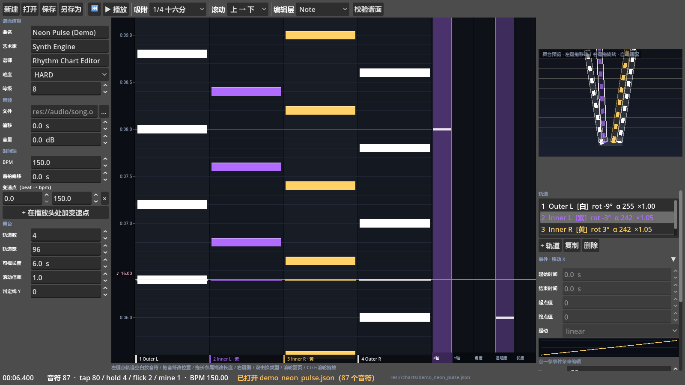
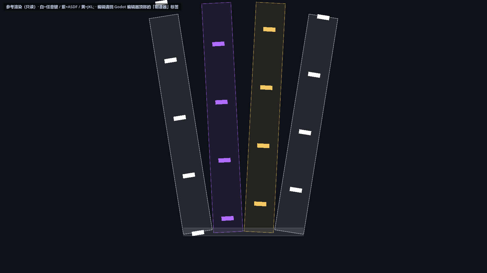

# Rhythm · Godot 谱面工具链

给 Godot 4.x 音游用的一套东西：

1. **`rchart` JSON 谱面格式** —— 人能手写、程序能容错读、编辑器能无损存。
   格式全文见 [docs/CHART_FORMAT.md](docs/CHART_FORMAT.md)。
2. **可视化制谱器** —— Godot EditorPlugin，编辑器里多一个「制谱器」主屏幕标签。
   N 轨可配置，每轨独立 **位移 / 旋转 / 透明度(0~255) / 长度**，动画用 **事件** 写
   （PhiEdit / Phigros 那套：起止时间 + 起止值 + 缓动曲线，右侧带事件面板和曲线预览）。
   安装与操作见 [addons/rhythm_chart_editor/README.md](addons/rhythm_chart_editor/README.md)。
3. **游戏侧参考实现** —— `examples/chart_stage_2d.gd`，把格式的舞台语义钉死。

## 长什么样
制谱器（左边信息 / 中间时间轴 / 右上舞台预览 / 右下轨道检查器）：



游戏侧参考渲染（同一份谱面，按 JSON 里的轨道变换画）：



两张图都是 `test/shot.tscn` 真跑一遍界面再抓的，不是手绘。

## 快速开始

**1. 打开这个工程**（Godot 4.x）

```bash
# 方式 A：命令行
godot --path . --editor
# 方式 B：Godot 项目管理器 → 导入 → 选本目录的 project.godot
# 方式 C：把 project.godot 直接拖到 Godot 图标上
```

**2. 看制谱器**：编辑器顶部 `2D / 3D / Script` 那一排会多一个 **「制谱器」** 标签页。
点开 → 点「打开」→ 选 `charts/demo_neon_pulse.json`（示例谱面，150 BPM / 87 音符 / 4 轨扇形）。

> 示例谱面没指定音频，所以先「空放」走播放头。想试听就点「音频 → 文件」右边的 `…`
> 选任意 ogg / mp3 / wav（不用先拷进项目）。

**3. 看游戏侧渲染**：按 `F5`（主场景已经指向 `examples/demo_stage.tscn`），
能看到同一份谱面按轨道变换画出来的下落效果。

> 注意：这个工程是**插件宿主**，不是游戏本体。所以「玩」的意思在制谱器标签页里，
> 而 `F5` 跑的是示例渲染器 —— 两者都值得各看一次。

不想建工程的话，直接把 `addons/rhythm_chart_editor/` 拷进你现有工程的 `addons/` 下，
再在 **项目设置 → 插件** 里勾选即可。

示例谱面：[charts/demo_neon_pulse.json](charts/demo_neon_pulse.json)
（150 BPM、87 个音符、4 轨扇形展开，带 hold / flick / mine）。

## 目录

```
project.godot                     宿主工程（插件已启用）
addons/rhythm_chart_editor/       制谱器插件 ← 要拷走的就是这个
  plugin.cfg / plugin.gd
  core/                           数据层（编辑器与运行时共用，无编辑器依赖）
  ui/                             时间轴 / 舞台预览 / 主界面
charts/demo_neon_pulse.json       示例谱面
docs/CHART_FORMAT.md              格式规范（字段表 + 语义 + 容错规则）
examples/chart_stage_2d.gd        游戏侧参考渲染器
examples/demo_stage.tscn          直接能跑的可视 demo
test/                             headless 自测（不需要显卡）
```

## 自测

需要 Godot 4.x 可执行文件（`godot` 在 PATH 里，或换成完整路径）：

```bash
# 1) 先扫一遍工程，生成 class_name 缓存
godot --headless --path . --editor --quit

# 2) 数据层：序列化 / BPM 换算 / 存读往返 / 校验 / 示例谱面
godot --headless --path . --script res://test/run_core_tests.gd

# 3) 制谱器 UI：建界面 → 加音符 → 几何 → 撤销 → 存盘 → 读回 → 真跑一次绘制
godot --headless --path . --script res://test/run_ui_smoke.gd

# 4) 游戏侧参考渲染器
godot --headless --path . --script res://test/run_stage_smoke.gd

# 5) 性能回归：4000 音符 / 8 轨下，每帧只允许扫视口内的音符
godot --headless --path . --script res://test/run_perf_test.gd
```

当前结果：核心 100 项全过，UI 冒烟全过，舞台渲染全过，性能回归全过
（4000 音符 8 轨：时间轴每帧 75 个音符、预览布局每帧 1 次、约 6.9ms/帧）。

性能上有两条硬约束，改动 UI 时别破坏：

1. **舞台预览的布局（包围盒 + 适配缩放）每帧只算一次**。写外了就是"每个音符算一次全量布局"，
   几千音符直接卡死 —— `debug_layout_calls` 就是盯这个的。
2. **两个视图都靠 `doc.index_at_time()` 二分跳过视口外音符**，不是全量遍历。
   `debug_notes_visited` 盯这个。

重新生成文档里的两张截图（需要能开窗口）：

```bash
godot --path . res://test/shot.tscn --resolution 1600x900 --quit-after 600
# 产物在 user:// 下：shot_editor.png / shot_stage.png
```

## 一屏看懂格式

```json
{
  "timing": { "bpm": 150.0, "beat_offset": 0.0 },
  "stage":  { "lane_count": 4, "lane_width": 96.0, "highway_length": 6.0, "scroll_speed": 1.0 },
  "lanes": [
    { "name": "Outer L", "color": "#4cc9f0",
      "position": { "x": -150.0, "y": 0.0 },
      "rotation_deg": -9.0, "alpha": 1.0, "length_scale": 1.0,
      "visible": true, "volume": 1.0 }
  ],
  "notes": [
    { "id": 1, "time": 0.0, "lane": 0, "type": "tap" },
    { "id": 3, "time": 0.8, "lane": 2, "type": "hold", "duration": 0.8 }
  ]
}
```

时间用秒，BPM 只画网格。轨道顺序即轨道编号，`lanes[i]` 的变换只影响渲染，不影响判定。

## 许可

随便用。
