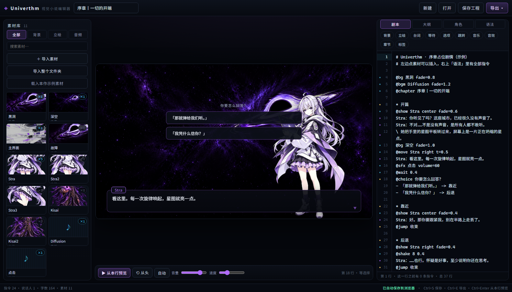

# 视觉小说编辑器（vn-editor）

一个**双击就能用**的网页工具：导入立绘 / 背景 / 音频 → 用纯文本写剧本 → 右边舞台立刻演给你看 → 导出给游戏用。
不依赖服务器、不打包、不上传，所有素材都留在你自己的浏览器里。

```
web/
  vn-editor.html        入口（双击打开）
  css/vn-editor.css     界面样式
  js/vn.js              剧本解析 / 工程读写 / 导出（不依赖 DOM，可以跑单测）
  js/vn-editor.js       素材库、舞台预览、导出按钮
  test/vn.test.js       解析层的单测（node）
  test/editor.browser.js  真开一个 Chrome 把编辑器跑一遍（node）
```

> 打开方式：直接双击 `web/vn-editor.html`。
> 第一次打开会载入**本作示例素材**（`../game/assets/banners/*.png` 等，用的是相对路径）和一段占位序章，
> 可以立刻点「▶ 从本行预览」听个响。换成自己的素材：左边「＋ 导入素材」或多选文件直接拖进窗口。



---

## 一、界面

| 区域 | 干什么 |
| --- | --- |
| 左 · 素材库 | `全部 / 背景 / 立绘 / 音频` 分类 + 搜索。拖文件进来也能导入。点一个素材看它被引用了几次、改名、改类型、插到光标处 |
| 中 · 舞台 | 16:9 预览。点舞台 / 空格 / 回车 = 继续；「▶ 从本行预览」从光标那一行开始演；「自动」会自己往下走；音量 / 速度（打字速度）只是试听用 |
| 右 · 剧本 | 手写剧本，左边行号上有彩点标出这一行是什么：青 = 指令、紫 = 台词/旁白、金 = 分支跳转、红 = 有错 |
| 右 · 大纲 | 所有标签（跳转落点）+ 编号，点一条跳过去；下面「问题」列解析错误，点一下定位到那一行 |
| 右 · 角色 | 每个说话人的名字颜色（名字板用）和默认立绘；下面有台词数 / 旁白数 / 字数 |
| 右 · 语法 | 全部指令速查 |

快捷键：`Ctrl+S` 存工程文件、`Ctrl+E` 导出菜单、`Ctrl+Enter` 从光标行预览。输入框外用空格 / 回车继续。

**自动保存**：改一个字就写进浏览器（IndexedDB）。个别环境（比如用 `file://` 打开且浏览器禁用 IndexedDB）会退化成 localStorage，只存得下剧本、素材要手动存工程——状态栏右下角会写清楚当前是哪种。

---

## 二、剧本怎么写

**一行一条**。空行、`#` 或 `//` 开头的行会被忽略。

```text
# 注释
@bg 教室 fade=0.8              ← 换背景（0.8 秒交叉淡化）
@show Stra center fade=0.5     ← 在中间显示立绘
Stra：你听见了吗？              ← 台词（中英文冒号都认）
她把手里的平板转过来。          ← 旁白
@move Stra right t=0.5         ← 挪到右边（带补间）
@hide Stra fade=0.3            ← 收起来
```

### 台词 / 旁白

- `名字：台词` —— 冒号前面的部分会当说话人，名字会出现在名字板上，颜色在「角色」页改。
- 没有冒号就是旁白。
- 旁白里**本来就有冒号**时（`她只说了一句话：走吧`），行首加一个反斜杠：`\ 她只说了一句话：走吧`。
  名字里带标点、或者很长，就不会被当成说话人——「大纲」页也会把这类可疑行标出来。

### 标签 / 分支

```text
* 开篇                          ← 标签（也可以写 @label 开篇）
@jump 结尾                      ← 跳过去

@choice 你要怎么回答？           ← 选项，下面连着写「- 文本 -> 标签」
- 「那就弹给我们听。」 -> 靠近
- 「我凭什么信你？」 -> 后退      ← 不写 -> 标签 就接着往下走

* 靠近
...
* 后退
...
* 结尾
@end                           ← 本段结束，停在结束画面
```

### 全部指令

| 指令 | 参数 | 说明 |
| --- | --- | --- |
| `@bg` | `<素材名> [fade=0.6]` | 换背景；写 `cut` 就是硬切 |
| `@show` | `<素材名> [left\|center\|right] [scale=100] [flip] [fade=0.35]` | 显示立绘 / 图片 |
| `@hide` | `<素材名\|all> [fade=0.3]` | 收起 |
| `@move` | `<素材名> <位置> [t=0.4]` | 换位（带补间） |
| `@clear` | `[fade=0.3]` | 清空所有立绘 |
| `@bgm` | `<素材名> [volume=100] [fade=1] [once]` | 背景音乐，默认循环 |
| `@bgmstop` | `[fade=1]` | 停背景音乐 |
| `@sfx` | `<素材名> [volume=100]` | 一次性音效 |
| `@wait` | `<秒>` | 等一会儿，自动继续 |
| `@shake` | `[强度=6] [时长=0.4]` | 画面震动 |
| `@flash` | `[颜色=#ffffff] [时长=0.3]` | 闪一下 |
| `@chapter` | `<标题>` | 黑场章节卡 |
| `@choice` | `[提示语]` | 选项 |
| `@jump` | `<标签>` | 跳转 |
| `@end` | `[结束语]` | 结束 |
| `@label` | `<标签>` | 定义标签（等于 `* 标签`） |

指令名也认中文：`@背景`/`@立绘`/`@显示`/`@隐藏`/`@移动`/`@清空`/`@音乐`/`@停止音乐`/`@音效`/`@等待`/`@震动`/`@闪白`/`@章节`/`@选择`/`@跳转`/`@结束`/`@标签`。
位置也认 `左 / 中 / 右`，还可以直接写数字（舞台宽度的百分比）。

---

## 三、导出

右上角「导出 ▾」有四个，导出的是**工程**和**引擎能直接读的数据**，互不替代：

| 导出 | 文件名 | 用途 |
| --- | --- | --- |
| 工程文件 | `<剧情名>.vnproj.json` | 全部内容 + 素材（base64 内嵌）。拖回窗口就能接着编，也可以拿去存档 / 备份 |
| 运行脚本 | `<剧情名>.vn.json` | 给游戏读的**纯数据**：素材只写文件名，指令是扁平数组，跳转已经解析成下标 |
| 独立播放器 | `<剧情名>.html` | 单文件、双击就演。发给别人看效果，或者嵌进网页 |
| 素材清单 | `<剧情名>.assets.json` | 只是「该把哪些文件拷进游戏目录」的清单 |

### `.vn.json` 的结构

```json
{
  "vn": 1,
  "format": "vnscript",
  "title": "序章丨一切的开端",
  "stage": { "width": 1280, "height": 720 },
  "characters": [
    { "name": "Stra", "color": "#b06bff", "sprite": "Stra", "lines": 5 }
  ],
  "assets": [
    { "name": "黑洞", "kind": "bg", "file": "黑洞.png", "bytes": 0 }
  ],
  "labels": [ { "name": "开篇", "index": 5, "line": 8 } ],
  "script": [
    { "op": "bg", "asset": "黑洞", "fade": 0.8, "line": 4 },
    { "op": "say", "who": "Stra", "text": "你听见了吗？", "line": 10 },
    { "op": "choice", "prompt": "你要怎么回答？", "line": 18,
      "options": [ { "text": "「那就弹给我们听。」", "label": "靠近", "index": 23 } ] },
    { "op": "jump", "label": "收束", "index": 33, "line": 25 }
  ]
}
```

- 素材按 **`name`** 引用，`file` 是要放进游戏目录的文件名（名字 + 按 MIME 推出来的扩展名）。
- `script` 是**扁平指令流**，引擎只要一个游标 `pc` 加一个 `while` 循环就能跑；
  `say` / `narr` / `choice` 会停住等玩家，其余指令瞬间生效。
- `jump.index` 和 `choice.options[].index` 已经解析成 `script` 里的下标，引擎不用自己查标签表；
  `line` 是它在剧本里的原始行号，报错和调试时对得上。
- 立绘位置 `x` 是舞台宽度的百分比（left ≈ 23、center = 50、right ≈ 77）。

### 接到游戏里

1. 把 `assets[].file` 列出的文件按原文件名拷进工程素材目录（例如 `game/assets/vn/`）。
2. 把 `.vn.json` 放进 `game/剧情/`（或 `user://` 下，玩家目录）。
3. 引擎侧按 `script` 逐条执行：`bg/show/hide/move` 挂背景与立绘节点，`say/narr` 打字机 + 等输入，
   `choice` 弹按钮并把游标设成 `options[i].index`，`jump` 直接 `pc = index`，`bgm/sfx` 放音频。

参考（GDScript 伪代码，只示范结构）：

```gdscript
var rt: Dictionary = JSON.parse_string(FileAccess.get_file_as_string(path))
var pc := 0
var steps: Array = rt["script"]
while pc < steps.size():
    var s: Dictionary = steps[pc]
    match s["op"]:
        "say", "narr":
            await show_line(s.get("who", ""), s["text"])   # 打字机 + 等玩家点
        "choice":
            var pick: int = await show_choices(s["options"])
            pc = int(s["options"][pick]["index"])
            continue
        "jump":
            pc = int(s["index"])
            continue
        "bg":
            set_background(s["asset"], float(s.get("fade", 0.6)))
        # ... show / hide / move / bgm / sfx / wait / shake / flash / chapter
    pc += 1
```

> 和现有的「收藏品 · 剧情」(`剧情/*.txt`) 不冲突：那边是纯文本阅读器，这边是有立绘、有分支、有音乐的场景演出。
> 想让某段剧本在通关第 N 首之后解锁，沿用现有的掉落约定即可（按文件名排序 + `collection.cfg` 记已解锁）。

---

## 四、注意

- **示例素材是相对路径**（`../game/assets/...`），只在本仓库里能显示。要带走或给游戏用，用「导入素材」重新导一遍（会变成内嵌数据）。
- 导出的播放器是**自带数据**的单文件；素材多的时候文件会很大（几十 MB 很正常）。
- 剧本里有笔误不会崩：解析错误在大纲页列出来、行号上标红点；预览会跳过坏行继续演。
- 立绘没有骨骼 / 表情差分，只做「显示、换位、缩放、镜像、淡入淡出」。要做表情差分，就一个表情一个素材名。

---

## 五、自测

```powershell
# 解析层单测（不依赖浏览器）
node web/test/vn.test.js

# 真开一个无头 Chrome 跑整页：启动 / 预览 / 分支 / 插入 / 三种导出
node web/test/editor.browser.js
```

`editor.browser.js` 没装 Chrome / Edge 会自动跳过（退出码 0）。
